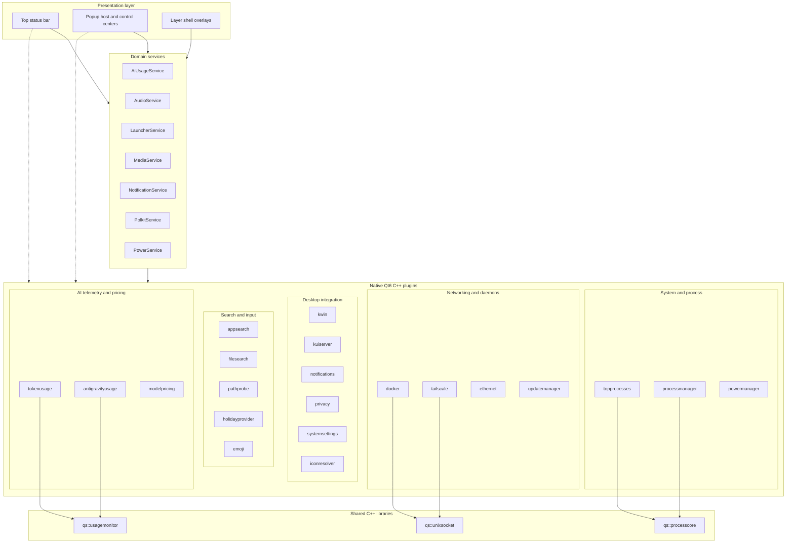

# quick-shell

Personal desktop bar, application launcher, and system control center built on [Quickshell](https://quickshell.org) and Qt 6 for Fedora Linux with KDE Plasma on KWin Wayland.

## Architecture

The shell combines a declarative QML interface with 21 compiled C++ plugins. These plugins query hardware, Linux sockets, and system daemons directly without spawning shell subprocesses.



## Features

### Application launcher and search

The launcher provides a modal search prompt above other desktop surfaces to find and start applications, execute commands, or manage running tasks. It indexes desktop applications using fuzzy matching and searches executables in the system path. It also locates files, directories, and KDE System Settings modules. When the user launches an application, the shell wraps the command in a transient user systemd scope so that shell restarts or crashes leave the application running. Users can pin applications to a quick launch row, execute terminal commands directly, or terminate running processes from the search results.

### Emoji picker and direct paste

The emoji view allows users to browse and insert Unicode emojis into any active application without manual clipboard copying. It categorizes emojis, tracks recently selected items, and filters by search text or skin tone. It connects to the XDG desktop portal and uses libei to inject synthetic keypresses directly into the focused window. Users can paste an emoji immediately or assemble multiple emojis before insertion.

### System and process monitoring

This feature tracks hardware resource usage and allows the user to manage rogue processes. The top status bar reports aggregate processor and memory utilization. The process control center expands this view with per-core processor charts, swap metrics, and process lists ranked by memory or processor share. Users can inspect separate private and shared resident memory figures for any task and terminate process trees with SIGTERM or SIGKILL signals.

### Audio and media playback

This feature manages sound levels and controls media playback across desktop devices. The status bar displays active PipeWire volume and current playback state. Middle clicking the volume icon switches audio output between headphones and line out jacks. The volume control center exposes master sink and source controls alongside individual per-stream volume sliders. The media control center connects to MPRIS players to display track metadata, album art, position sliders, and playback controls.

### Network, Tailscale mesh, and speed test

This feature monitors connection quality, checks link metrics, and manages private mesh network connections. The Ethernet control center reports network carrier state, interface configuration, gateway ping latency, and real-time bandwidth. An integrated speed test runs against Cloudflare endpoints to measure download rates, upload rates, latency, and jitter. The Tailscale control center connects to the local tailscaled daemon socket to report node state, MagicDNS names, advertised routes, and peer device availability.

### Docker container management

This feature allows users to inspect and control local container instances without opening a terminal. The Docker plugin connects directly to the local Docker Unix socket through an asynchronous HTTP client. The status bar displays the count of active containers. The container control center allows users to start, stop, pause, restart, or remove containers, inspect storage usage, and read container log output.

### Notifications and file transfer progress

This feature displays incoming desktop alerts and tracks long running file transfers. The overlay layer displays transient notification toasts and KIO file operation progress cards. A dedicated notification center groups unread alerts by application name, supports inline replies, and toggles do not disturb mode.

### AI token tracking and cost estimation

This feature measures daily and monthly language model token usage and expenses. The shell reads local OpenCode SQLite databases and Antigravity JSONL session transcripts. It records input tokens, output tokens, reasoning tokens, and cache hits. The telemetry control center renders token volume charts and calculates monetary costs using local pricing tables.

### Package update management

This feature tracks available operating system updates and applies them cleanly. The update manager communicates with DNF5 over D-Bus without creating separate package manager processes. It shows the number of available package updates in the status bar. The control center displays package lists, changelog notes, and triggers offline system updates.

### Hardware privacy indicators

This feature alerts the user when hardware sensors capture audio or video. The privacy monitor checks PipeWire audio streams and Linux video devices. The status bar displays active recording warnings, while the privacy control center lists the specific applications and device nodes capturing input.

### Desktop integration and authentication

This feature coordinates window tasks, displays system tray icons, and presents privilege elevation prompts. The shell integrates with KWin through Wayland protocols to track window focus and manage taskbar entries. It hosts StatusNotifierItem system tray icons. A calendar control center parses local iCalendar files to display dates and public holidays. An integrated Polkit authentication agent prompts for passwords when desktop actions require root privileges.

### Power and session management

This feature controls desktop session states and machine power. The power control center presents quick actions to lock the screen, suspend the system, reboot, power down, or log out of the current user session through systemd and KDE session services.

## Native C++ plugins and shared libraries

### Shared C++ libraries

- `qs::unixsocket` in `libs/unixsocket`: Asynchronous HTTP/1.1 client that communicates directly over Unix domain sockets such as `/var/run/docker.sock` and `/var/run/tailscale/tailscaled.sock`.
- `qs::usagemonitor` in `libs/usagemonitor`: Shared telemetry base that tracks token counts, manages worker threads, calculates calendar date windows, and saves atomic JSON cache files.
- `qs::processcore` in `libs/processcore`: Linux process utilities for process tree root lookup, resident memory formatting, and recursive process tree termination.

### Native C++ plugins

| Plugin | QML URI | Description |
|---|---|---|
| **antigravityusage** | `Quickshell.Plugins.AntigravityUsage` | Scans Antigravity JSONL session transcripts to track token consumption, cache hits, and estimated costs. |
| **appsearch** | `Quickshell.Plugins.AppSearch` | Desktop application ranker that implements fuzzy token scoring. |
| **docker** | `Quickshell.Plugins.Docker` | Docker daemon socket client that monitors container status, Compose projects, log streams, and lifecycle operations. |
| **emoji** | `Quickshell.Plugins.Emoji` | Unicode emoji database provider with search, skin tone variants, and libei virtual input injection for auto-pasting into active windows. |
| **ethernet** | `Quickshell.Plugins.Ethernet` | Netlink and Ethtool carrier monitor, gateway ping latency prober, and network interface throughput tracker. |
| **filesearch** | `Quickshell.Plugins.FileSearch` | Asynchronous filesystem search pipeline that runs fd and rg to locate files and directories. |
| **holidayprovider** | `Quickshell.Plugins.HolidayProvider` | iCalendar parser and file watcher that indexes holiday dates for calendar views. |
| **iconresolver** | `Quickshell.Plugins.IconResolver` | Freedesktop and XDG icon name, path, and application ID resolver with fallback resolution. |
| **kuiserver** | `Quickshell.Plugins.KuiServer` | Implementation of the KDE Kuiserver D-Bus specification to track KIO file jobs and transfer speeds. |
| **kwin** | `Quickshell.Plugins.KWin` | Interfaces with the KWin Wayland compositor over D-Bus for window tracking, activation, and state correlation. |
| **modelpricing** | `Quickshell.Plugins.ModelPricing` | Language model token pricing parser that calculates costs across input, output, cache read, cache write, and reasoning tokens. |
| **notifications** | `Quickshell.Plugins.Notifications` | In-process notification history store, Qt list model, and action dispatcher. |
| **pathprobe** | `Quickshell.Plugins.PathProbe` | In-process query classifier that resolves tilde paths, filesystem paths, binary executables in PATH, and MIME types. |
| **powermanager** | `Quickshell.Plugins.PowerManager` | System session controller that triggers shutdown, reboot, logout, suspend, and lock via loginctl and KDE D-Bus. |
| **privacy** | `Quickshell.Plugins.Privacy` | Active audio and video recording stream monitor that checks PipeWire and device nodes. |
| **processmanager** | `Quickshell.Plugins.ProcessManager` | Multi-threaded Linux proc reader, process tree signal dispatcher, and systemd unit controller. |
| **systemsettings** | `Quickshell.Plugins.SystemSettings` | Discovers and launches KDE System Settings modules and actions. |
| **tailscale** | `Quickshell.Plugins.Tailscale` | Tailscale daemon socket client that monitors node state, MagicDNS, Funnel and Serve routes, and peer devices. |
| **tokenusage** | `Quickshell.Plugins.TokenUsage` | Queries OpenCode SQLite storage to aggregate session token counts and costs. |
| **topprocesses** | `Quickshell.Plugins.TopProcesses` | On-demand Linux proc poller that calculates system and per-process processor and memory metrics. |
| **updatemanager** | `Quickshell.Plugins.UpdateManager` | DNF5 D-Bus client that tracks available package updates, changelogs, transaction progress, and triggers upgrades. |

## Build and installation

### Build all plugins

Build all 21 native C++ plugins and shared libraries with CMake and Ninja:

```bash
cmake -S . -B build -G Ninja -DCMAKE_BUILD_TYPE=Release
cmake --build build
```

### Build a single plugin target

To build an individual plugin target:

```bash
cmake --build build --target docker
```

### Configure a subset of plugins

To configure and build only specific plugins:

```bash
cmake -S . -B build -DQS_PLUGINS="docker;tailscale"
cmake --build build
```

### Run QML lint

Run QML static analysis across all shell QML files:

```bash
cmake --build build --target qmllint
```

## Running

Launch the shell with Quickshell:

```bash
quickshell -p /home/dev/Projects/quick-shell
```

Quickshell automatically reloads changes when QML files change.

## IPC control reference

Interact with the running shell through terminal commands, scripts, or window manager shortcuts with `quickshell ipc call`:

### Launcher controls

```bash
# Toggle modal launcher visibility
quickshell ipc call launcher toggle

# Open modal launcher
quickshell ipc call launcher open

# Close modal launcher
quickshell ipc call launcher close

# Open modal launcher with an initial search query
quickshell ipc call launcher openWith "query"

# Toggle emoji picker view
quickshell ipc call launcher toggleEmoji

# Open emoji picker view directly
quickshell ipc call launcher openEmoji
```

### Dynamic popup controls

```bash
# Open a specific control center popup
quickshell ipc call popup open proc
quickshell ipc call popup open ai
quickshell ipc call popup open cal
quickshell ipc call popup open media
quickshell ipc call popup open docker
quickshell ipc call popup open ts
quickshell ipc call popup open update
quickshell ipc call popup open eth
quickshell ipc call popup open speedtest
quickshell ipc call popup open bluetooth
quickshell ipc call popup open vol
quickshell ipc call popup open notif
quickshell ipc call popup open power
quickshell ipc call popup open privacy

# Close any open popup
quickshell ipc call popup close
```

| Target name | Control center |
|---|---|
| `proc` | Top processes |
| `ai` | AI token telemetry |
| `cal` | Calendar and holidays |
| `media` | Media playback |
| `docker` | Docker containers |
| `ts` | Tailscale mesh |
| `update` | Package updates |
| `eth` | Ethernet interface |
| `speedtest` | Network speed test |
| `bluetooth` | Bluetooth devices |
| `vol` | Volume and audio streams |
| `notif` | Notification history |
| `power` | Session power actions |
| `privacy` | Hardware recording status |

### Polkit authentication agent controls

```bash
# Enable the authentication agent
quickshell ipc call polkit enable

# Disable the authentication agent
quickshell ipc call polkit disable

# Toggle the authentication agent
quickshell ipc call polkit toggle

# Check the registration status
quickshell ipc call polkit status
```
