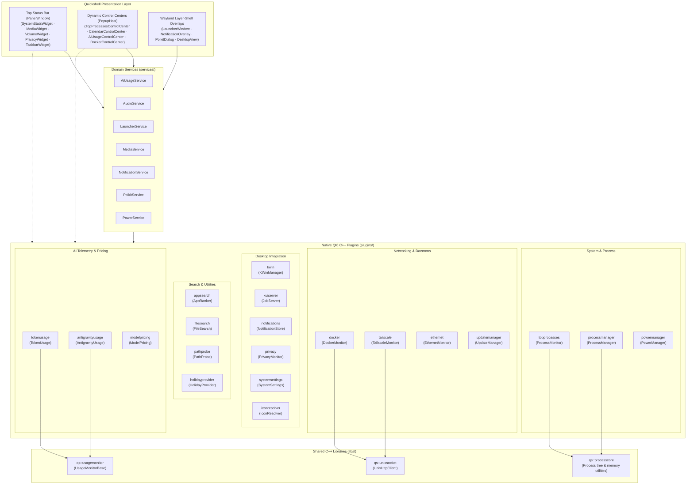

# quick-shell

Personal desktop bar, application launcher, and system control center built on [Quickshell](https://quickshell.org) and Qt 6 for Fedora Linux with KDE Plasma on KWin Wayland.

## Architecture

The shell combines a declarative QML interface with compiled C++ plugins that query hardware, sockets, and system daemons directly without spawning shell subprocesses.



## Presentation Surfaces & Controls

### Top Status Bar (`widgets/`)

A per-screen Wayland top panel running on `WlrLayer.Top` with an exclusive zone:
- **`SystemStatsWidget`**: Real-time CPU and RAM utilization metrics backed by `ProcessMonitor`.
- **`MediaWidget`**: Active MPRIS track info, playback controls, and artist/title marquee.
- **`VolumeWidget`**: PipeWire master sink volume level, mute state, and dynamic icons.
- **`PrivacyWidget`**: Active recording hardware indicators for microphones and cameras.
- **`TaskbarWidget`**: Running application window strip with KWin window activation and state tracking.
- **`AiUsageWidget`**: Today's AI token usage split across OpenCode and Antigravity.
- **`DockerWidget`**: Local Docker daemon state badge and running container count.
- **`TailscaleWidget`**: Tailscale mesh network status and Funnel/Serve indicators.
- **`UpdateWidget`**: DNF5 available package updates count and transaction state.
- **`EthernetWidget`**: Physical link status, internet connectivity, and transfer speeds.
- **`BluetoothWidget`**: Bluetooth adapter status and connected device count.
- **`NotificationWidget`**: Unread notification counter and Do Not Disturb state.
- **`PowerWidget`**: Session power menu trigger.
- **`LauncherWidget`**: Application launcher toggle button.
- **`SystemTrayWidget`**: Embedded StatusNotifierItem system tray host.

### Control Centers & Dynamic Popups (`popups/`)

Transient interactive control centers hosted on demand by a single dynamic `PopupWindow` (`PopupHost.qml`):
- **`TopProcessesControlCenter`**: On-demand process inspector with CPU/RAM metrics, sortable columns, and process tree termination.
- **`CalendarControlCenter`**: Month grid with holiday event tooltips and day selection backed by `HolidayProvider`.
- **`AiUsageControlCenter`**: Token analytics dashboard featuring donut cards, timeline charts, and per-model cost breakdowns.
- **`DockerControlCenter`**: Container inventory, real-time log viewer, and container lifecycle actions (start, stop, restart, pause, delete).
- **`VolumeControlCenter`**: Master audio sink/source sliders and per-application audio stream controls.
- **`EthernetControlCenter`**: Network interface configuration, gateway ping diagnostics, and link throughput graphs.
- **`TailscaleControlCenter`**: Local node status, MagicDNS address, Funnel/Serve routes, and peer device inventory.
- **`UpdateControlCenter`**: Available DNF5 package updates, changelog viewer, and offline update execution.
- **`MediaControlCenter`**: Expanded media player controls, album artwork, track seek slider, and player selector.
- **`NotificationControlCenter`**: Notification history grouped by application, inline reply fields, and Do Not Disturb controls.
- **`PrivacyControlCenter`**: Active recording applications, audio nodes, and camera devices.
- **`BluetoothControlCenter`**: Bluetooth controller toggle, discovery mode, and paired device management.
- **`PowerControlCenter`**: Quick system session actions (lock, suspend, reboot, shutdown, logout).

### Overlays & Secondary Surfaces

- **`LauncherWindow` (`launcher/`)**: Spotlight-style modal search on `WlrLayer.Top` combining desktop applications, files, system settings, inline terminal commands, process killing, and pinned application dock.
- **`NotificationOverlay` (`popups/`)**: Layer-shell overlay (`WlrLayer.Overlay`) hosting queued notification toasts and KIO file operation progress cards from `JobServer`.
- **`PolkitDialog` (`popups/`)**: System authentication dialog for privilege escalation requests on `WlrLayer.Overlay`.
- **`DesktopView` (`desktop/`)**: Per-screen desktop background on `WlrLayer.Bottom` rendering desktop wallpaper and capturing desktop context clicks.

## Native C++ Plugins & Shared Libraries

### Shared C++ Libraries (`libs/`)

- **`qs::unixsocket` (`libs/unixsocket`)**: Non-blocking HTTP/1.1 client (`UnixHttpClient`) communicating directly over Unix domain sockets (`/var/run/docker.sock`, `/var/run/tailscale/tailscaled.sock`).
- **`qs::usagemonitor` (`libs/usagemonitor`)**: Common token telemetry engine providing `UsageMonitorBase`, thread-safe worker coordination (`UsageWorker`), calendar window bound calculation in Asia/Kolkata timezone, and atomic JSON caching with `QSaveFile`.
- **`qs::processcore` (`libs/processcore`)**: Shared Linux process utilities providing fast process tree root lookup (`getRootFast`), RSS memory string formatting (`formatRssKb`), and recursive process tree termination (`killProcessTree`).

### Native C++ Plugins (`plugins/`)

| Plugin | QML URI | Description |
|---|---|---|
| **antigravityusage** | `Quickshell.Plugins.AntigravityUsage` | Scans Antigravity JSONL session transcripts, tracking daily/weekly/monthly token consumption, cache hits, and estimated costs. |
| **appsearch** | `Quickshell.Plugins.AppSearch` | High-performance desktop application ranker (`AppRanker`) implementing fuzzy token scoring. |
| **docker** | `Quickshell.Plugins.Docker` | Direct Docker daemon socket client monitoring container status, Compose projects, log streams, and lifecycle operations. |
| **ethernet** | `Quickshell.Plugins.Ethernet` | Netlink/Ethtool network carrier monitor, gateway ping latency prober, and demand-driven `/sys/class/net` throughput tracker. |
| **filesearch** | `Quickshell.Plugins.FileSearch` | Asynchronous filesystem search pipeline wrapping `fd` and `rg` for rapid file and directory resolution. |
| **holidayprovider** | `Quickshell.Plugins.HolidayProvider` | iCalendar (`.ics`) parser and file watcher indexing holiday events by date for fast QML query. |
| **iconresolver** | `Quickshell.Plugins.IconResolver` | Freedesktop and XDG icon name, path, and application ID resolver with fallback resolution. |
| **kuiserver** | `Quickshell.Plugins.KuiServer` | Implementation of KDE Kuiserver D-Bus specification (`org.kde.kuiserver`) tracking KIO file job operations and transfer speeds. |
| **kwin** | `Quickshell.Plugins.KWin` | Interfaces with KWin Wayland compositor over D-Bus and scripting for window tracking, activation, and dock correlation. |
| **modelpricing** | `Quickshell.Plugins.ModelPricing` | LLM token pricing configuration parser calculating costs across input, output, cache read/write, and reasoning tokens. |
| **notifications** | `Quickshell.Plugins.Notifications` | In-process notification history store, Qt list model, and action/reply dispatcher. |
| **pathprobe** | `Quickshell.Plugins.PathProbe` | In-process query classifier resolving tilde paths, filesystem paths, binary executables in PATH, and MIME types. |
| **powermanager** | `Quickshell.Plugins.PowerManager` | System session and power manager triggering shutdown, reboot, logout, suspend, and lock via loginctl and KDE D-Bus. |
| **privacy** | `Quickshell.Plugins.Privacy` | Active audio/video recording stream monitor querying PipeWire and ALSA/V4L2 device nodes. |
| **processmanager** | `Quickshell.Plugins.ProcessManager` | Multi-threaded `/proc` reader, signal dispatcher (SIGTERM, SIGKILL with process tree killing), and systemd system/user unit controller. |
| **systemsettings** | `Quickshell.Plugins.SystemSettings` | Discovers and launches KDE System Settings modules (KCMs) and actions. |
| **tailscale** | `Quickshell.Plugins.Tailscale` | Tailscale daemon socket client monitoring node state, MagicDNS, Funnel/Serve routes, and peer device inventory. |
| **tokenusage** | `Quickshell.Plugins.TokenUsage` | Queries OpenCode SQLite storage to aggregate session token counts and costs. |
| **topprocesses** | `Quickshell.Plugins.TopProcesses` | On-demand Linux `/proc` poller computing system and per-process CPU, memory, and ranked process lists. |
| **updatemanager** | `Quickshell.Plugins.UpdateManager` | DNF5 D-Bus client tracking available package updates, changelogs, transaction progress, and triggering upgrades. |

## Build and Installation

### Build All Plugins

Build all 20 native C++ plugins and shared libraries using CMake and Ninja:

```bash
cmake -S . -B build -G Ninja -DCMAKE_BUILD_TYPE=Release
cmake --build build
```

### Build a Single Plugin Target

To build an individual plugin target:

```bash
cmake --build build --target docker
```

### Configure a Subset of Plugins

To configure and build only specific plugins:

```bash
cmake -S . -B build -DQS_PLUGINS="docker;tailscale"
cmake --build build
```

### Run QML Lint

Run QML static analysis across all shell QML files:

```bash
cmake --build build --target qmllint
```

## Running

Launch the shell with Quickshell:

```bash
quickshell -p /home/dev/Projects/quick-shell
```

Quickshell hot-reloads interface changes automatically when QML files are edited.

## IPC Control Reference

Interact with the running shell from terminal commands, shell scripts, or KWin window manager shortcuts via `quickshell ipc call`:

### Launcher Controls

```bash
# Toggle modal launcher visibility
quickshell ipc call launcher toggle

# Open modal launcher
quickshell ipc call launcher open

# Close modal launcher
quickshell ipc call launcher close
```

### Dynamic Popup Controls

```bash
# Open specific control center popup
quickshell ipc call popup open proc       # TopProcessesControlCenter
quickshell ipc call popup open ai         # AiUsageControlCenter
quickshell ipc call popup open cal        # CalendarControlCenter
quickshell ipc call popup open media      # MediaControlCenter
quickshell ipc call popup open docker     # DockerControlCenter
quickshell ipc call popup open ts         # TailscaleControlCenter
quickshell ipc call popup open update     # UpdateControlCenter
quickshell ipc call popup open eth        # EthernetControlCenter
quickshell ipc call popup open bluetooth  # BluetoothControlCenter
quickshell ipc call popup open vol        # VolumeControlCenter
quickshell ipc call popup open notif      # NotificationControlCenter
quickshell ipc call popup open power      # PowerControlCenter
quickshell ipc call popup open privacy    # PrivacyControlCenter

# Close any currently open popup
quickshell ipc call popup close
```

### Polkit Authentication Agent Controls

```bash
# Enable in-shell polkit authentication agent
quickshell ipc call polkit enable

# Disable in-shell polkit authentication agent
quickshell ipc call polkit disable

# Toggle polkit authentication agent status
quickshell ipc call polkit toggle

# Check polkit authentication agent registration status ("registered", "failed", "disabled")
quickshell ipc call polkit status
```
